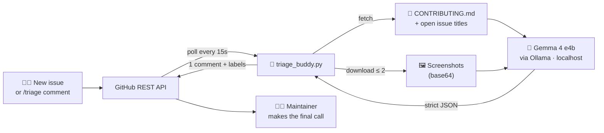

<div align="center">

# 🤖 Triage Buddy

### Your repo's friendly first responder: open-source, self-hosted, powered by Gemma 4

**Triage Buddy reads every new GitHub issue, including its screenshots. It asks the author for missing details, spots duplicates and labels the issue in seconds. Everything runs on your own machine.**


[Demo](#-demo) · [How it works](#-how-it-works) · [Quick start](#-quick-start-windows) · [Results](#-results) · [Why Gemma 4](#-why-gemma-4)

</div>

---

## 🎬 Demo


<!-- TODO: record your screen (e.g. with ScreenToGif) and save it as docs/demo.gif -->

> A contributor opens an issue with only a screenshot of an error. Within seconds, Triage Buddy reads the stack trace from the image, labels the issue `bug` + `needs-info`, links a likely duplicate, and asks politely for the missing version number.

---

## 😩 The problem

Every open-source maintainer knows this loop:

1. A new issue arrives: *"It doesn't work"* plus a screenshot.
2. The maintainer replies: *"Which version? Which OS? Can you paste the error as text?"*
3. They search old issues: *"Isn't this the same as #42?"*
4. Repeat, dozens of times a week.

During **Hacktoberfest** the number of issues jumps. Real bugs get buried under low-effort reports, and maintainers spend their limited time on copy-paste replies instead of code. That's how burnout starts.

Existing AI bots help, but they send your community's data to a paid cloud API. Many open-source projects can't or won't accept that.

## 💡 The solution

**Triage Buddy** is a small Python bot (about 400 lines) that acts as a first responder for your repo. It uses **Gemma 4**, an open-weight multimodal model, running **locally** through Ollama.

| For every new issue, Triage Buddy... | |
|---|---|
| 🏷️ **Classifies** it | `bug` · `feature` · `docs` · `question` |
| 📋 **Checks it against your `CONTRIBUTING.md`** | and posts a checklist of exactly what's missing |
| 🔍 **Reads screenshots** | error text, versions and stack traces inside images |
| 🔁 **Finds possible duplicates** | among your other open issues, with links |
| 🚩 **Flags low-effort or spam** | for a human to review |
| 💬 **Replies once, kindly** | one welcoming comment, not a wall of bot spam |
| 🔄 **Re-runs on request** | a maintainer comments `/triage` |

And just as important, here is what it **never** does: close, lock or delete anything. **A human maintainer always makes the final call.**

---

## 💬 What a Triage Buddy comment looks like

> Thanks for reporting this, @contributor! 🙌 It looks like the app crashes when you save a file with a non-ASCII name. That's a clear description, and the screenshot helps a lot.
>
> **🔍 From your screenshot:**
> `UnicodeEncodeError: 'charmap' codec can't encode character 'é'` in `save.py`, line 88. App version shown in the title bar: v2.3.1.
>
> 🔁 Possibly related: #12
>
> **To help a maintainer pick this up, could you add:**
> - [ ] Your operating system and version
> - [ ] Steps to reproduce the crash
>
> ---
> <sub>🤖 Triage Buddy · Gemma 4 running locally · a human maintainer makes the final call</sub>

**Labels added:** `bug` `needs-info` `possible-duplicate`

*(Illustrative example of the comment format.)*

---

## ⚙️ How it works



1. **Watch.** The bot polls the repo's open issues every 15 seconds and skips pull requests. Issues that existed before startup are marked as seen, so only **new** issues get triaged.
2. **Gather context.** It fetches the repo's `CONTRIBUTING.md` (or uses a sensible default checklist) and the titles of all other open issues.
3. **See.** Up to two screenshots (`github.com/user-attachments/...`, `.png`, `.jpg`) are downloaded and sent to Gemma 4 as images.
4. **Think.** Gemma 4 answers in **strict JSON**: `type`, `missing_info`, `duplicate_of`, `low_effort`, `screenshot_findings`, `comment`.
5. **Validate.** Bad JSON is retried once. Duplicate numbers are checked against real open issues (no made-up links), and labels are limited to a fixed list.
6. **Act.** It posts **one** comment and adds labels. Then it goes back to watching.

---

## 🧠 Why Gemma 4

Triage Buddy is built around what makes Gemma 4 special:

- **👁️ Multimodal.** Many bug reports are *just a screenshot*. Gemma 4 reads error messages, version numbers and stack traces straight from the image, which a text-only bot would miss completely.
- **💻 Small enough for a laptop.** The `e4b` variant runs on everyday hardware through Ollama. No GPU cluster needed.
- **📐 Reliable structured output.** With Ollama's JSON mode, Gemma 4 returns machine-readable triage decisions the bot can trust and validate.
- **🔓 Open weights.** Anyone can run it, inspect it, and swap it with one line of config (`MODEL=` in `.env`).

### Why open-weight beats a cloud API here

| | 🤖 Triage Buddy (Gemma 4 + Ollama) | ☁️ Hosted AI API |
|---|---|---|
| **Privacy** | Issue text and screenshots never leave your machine | Sent to a third party |
| **Cost** | **$0** per issue, forever | Pay per token, grows with your community |
| **Control** | Self-hosted, any repo, any Ollama model | Vendor lock-in and rate limits |
| **Openness** | MIT code + open-weight model | Closed model |

---

## 📊 Results

`evaluate.py` is a **read-only** benchmark you can run against any public repo. It:

1. fetches the repo's 20 most recent closed issues labelled *duplicate*,
2. reads the maintainers' comments to find the **real** original each one duplicated,
3. hides that original among **30 other recent issues**, and
4. asks Gemma 4 the exact same duplicate question the bot asks.

**Nothing is posted.**

```powershell
python evaluate.py facebook/react
```

| Repository | Duplicates detected | Avg time per issue | Hardware |
|---|---|---|---|
| `facebook/react` | _X / Y_ | _Z s_ | _your laptop_ |
| `microsoft/vscode` | _X / Y_ | _Z s_ | _your laptop_ |

<!-- TODO: fill in with your own evaluate.py results before submitting -->

---

## 🚀 Quick start (Windows)

**You need:** Python 3.10+ and about 10 GB of free disk space for the model.

**1. Install Ollama** from <https://ollama.com/download>. It runs in the background (look for the llama icon in the system tray).

**2. Download Gemma 4**
```powershell
ollama pull gemma4:e4b
```

**3. Install the Python libraries**
```powershell
pip install -r requirements.txt
```

**4. Configure**
```powershell
copy .env.example .env
notepad .env
```
Set `REPO=your-username/your-repo` and `GITHUB_TOKEN=...`. Create a [fine-grained token](https://github.com/settings/personal-access-tokens/new) for that repo with **Issues: Read and write** and **Contents: Read-only**.

**5. Run**
```powershell
python triage_buddy.py
```

```
09:30:01  Triage Buddy starting for you/demo with model gemma4:e4b
09:30:02  Marked 4 existing issue(s) as seen. Watching for new ones every 15s (Ctrl+C to stop).
09:31:17  [#5] triaging... "App crashes when saving"
09:31:17  [#5] found 1 image link(s), sending 1 to Gemma
09:31:29  [#5] done: labels=['bug', 'needs-info'], 12.3s
```

Now open an issue on your repo and watch it work. 🎉

### Configuration

| Variable | Required | Default | Description |
|---|---|---|---|
| `REPO` | ✅ | | Repo to watch, e.g. `octocat/hello-world` |
| `GITHUB_TOKEN` | ✅ | | Token with Issues read/write + Contents read |
| `MODEL` | | `gemma4:e4b` | Any Ollama model tag |

---

## 🛡️ Safety by design

AI should help maintainers, not act on their behalf without asking. Triage Buddy is deliberately limited:

- ✅ **Only two write actions:** one comment and labels from a fixed list (`bug`, `feature`, `docs`, `question`, `needs-info`, `possible-duplicate`, `needs-human-review`).
- 🚫 **Never** closes, locks or deletes issues, comments or labels.
- 👮 **`/triage` is maintainer-only** (owner, members, collaborators).
- 🔗 **No made-up duplicates:** every suggested link is checked against real open issues.
- 🔑 **Your token stays secret:** it's read from a git-ignored `.env` and is never printed or written anywhere.
- 🧯 **Fails gracefully:** bad model output is retried once, then skipped and logged. The bot keeps running.

---

## 📁 Project structure

```
triage-buddy/
├── triage_buddy.py     # the bot: poll → gather context → Gemma 4 → comment + labels
├── evaluate.py         # read-only duplicate-detection benchmark
├── requirements.txt    # requests, python-dotenv (that's it!)
├── .env.example        # config template
├── LICENSE             # MIT
└── README.md
```

Just **two dependencies**. No framework, no database, no cloud.

---

## 🗺️ Roadmap

- [ ] GitHub App / webhook mode instead of polling
- [ ] Semantic duplicate search over closed issues using embeddings
- [ ] Suggest `good first issue` for beginner-friendly tasks
- [ ] Multilingual replies in the author's language
- [ ] Docker image for one-command deployment

---

## 🤝 Contributing

Contributions are welcome, especially during Hacktoberfest! Open an issue (Triage Buddy might even reply 😉) or send a pull request. Good places to start are the roadmap items above.

## 📜 License

Released under the [MIT License](LICENSE). Free to use, fork and improve.

## 🙏 Acknowledgements

- [Google Gemma](https://ai.google.dev/gemma) for the open-weight Gemma 4 model
- [Ollama](https://ollama.com) for making local models easy to run
- Every maintainer who has ever typed *"which version are you using?"* for the hundredth time ❤️

<div align="center">

**Built with ❤️ for open source · Hacktoberfest 2026**

</div>
